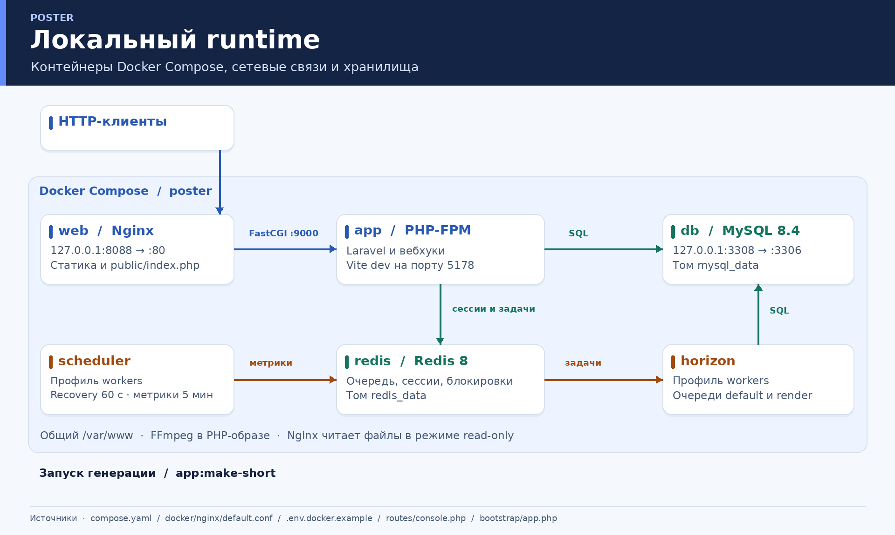

# Poster

Приложение на Laravel 13 / PHP 8.4 для генерации и публикации коротких видео с публичной
страницей разработчика и личным кабинетом на Vue/Inertia.

## Возможности

- Публичные страницы: профиль, политика, условия использования
- Регистрация, сессии, восстановление пароля и настройки профиля
- Проекты: поиск, создание, редактирование, каналы и история генераций;
  удаление пустых проектов с подтверждением
- Списки prompts и публикаций с сортировкой, фильтрами и пагинацией
- Генерация идеи и изображения через Laravel AI и Codex с подпиской ChatGPT,
  видео через Seedance/Hailuo/Runway; встроенный звук Seedance или музыка Suno,
  сборка ролика через FFmpeg
- Публикация в YouTube и Instagram, уведомления в Telegram
- Сериалы: паспорт, версии персонажей и приватные ракурсы, сценарии со сценами
  и планами, отдельные дубли, монтаж и ручное подтверждение событий
- Продолжение от принятого эпизода или выбранного дубля, сохранение контекста,
  отдельная публикация сборки и восстановление прерванных операций
- TikTok и VK пока представлены заглушками: публикация возвращает `false`

## Сериалы

В кабинете **Series** создайте сериал внутри проекта, добавьте персонажей,
загрузите изображения и утвердите версии внешности. Затем создайте эпизод,
введите сценарий или запросите его генерацию. Рабочий путь:

**Сценарий → утверждение → дубли планов → монтаж → подтверждение событий → публикация**

Кабинет сериалов доступен подтверждённому владельцу `ADMIN_EMAIL` и операторам
`HORIZON_ALLOWED_EMAILS`. Это общий операторский кабинет без пользовательских
tenant-аккаунтов. Права повторно проверяются перед внешними вызовами workers.
При изменении списка операторов пересоберите config cache и перезапустите workers.

Сценарий фиксирует конкретные версии персонажей и источник продолжения.
`continue_scene` продолжает действие от выбранного кадра, `new_shot` меняет
ракурс с учётом прежнего состояния, `new_scene` начинает новую сцену. История
обновляется после принятия просмотренного монтажа. Замена раннего результата
помечает последующие эпизоды как требующие проверки.

Паспорт задаёт `native` для встроенной речи/звука или `silent` для немого ролика.
Реплики допустимы только при поддержке аудио выбранной моделью. Немой режим
запрещает реплики и убирает фактический звук из монтажа. Голосовая спецификация
персонажа передаётся модели; постоянство голоса и лица требует живой приёмки.
Отдельные TTS, lip-sync, распознавание речи и субтитры пока не подключены.

Технические лимиты: до 10 персонажей сценария, 20 сцен, 100 планов и пяти минут
в эпизоде; 4–30 секунд на план с дополнительными ограничениями видеомодели;
до 10 дублей плана. Конвейер сериалов использует приватный кадр как вход видео,
а локальные референсы — при подготовке этого кадра. Режимы references/extend
видеодрайвера доступны в его DTO-контракте и требуют отдельной живой проверки.

Исходники персонажей, дубли и сборки находятся на приватном диске. Для
провайдера публикации выдаётся временный подписанный URL принятого видео.
Промежуточные дубли не попадают в обычный список prompts и автопубликацию shorts.
При неизвестном исходе задача автоматически повторно не отправляется:
проверьте существующий remote ID либо явно закройте неизвестную попытку с
пояснением. Генерация нового дубля остаётся отдельным действием.

Порядок настройки очередей и восстановления описан в
[развёртывании](docs/deployment.md#очереди-сериалов-и-восстановление).
Этапы и текущие ограничения — в
[плане реализации](docs/series-implementation-plan.md#17-текущее-состояние-реализации).

## Генерация и публикация


Для видео доступен BytePlus ModelArk / Seedance со встроенным звуком. После
применения миграций задайте `VIDEO_GENERATOR=seedance` и `SEEDANCE_API_KEY`.
По умолчанию выбрана модель `dreamina-seedance-2-0-mini-260615`, разрешение
`720p`; настройки — `SEEDANCE_MODEL` и `SEEDANCE_RESOLUTION`. Для 1080p используйте
`dreamina-seedance-2-5-260628`. Длительность берётся из `general.duration`:
Seedance 2.5 допускает 4–30 секунд, 2.0 — 4–15. Кадры Codex из public disk
`generated-images/` передаются Seedance прямо в запросе (Base64, до 30 МБ),
поэтому локальный `APP_URL` не мешает генерации. Остальные URL должны быть доступны
провайдеру извне. Формат видео повторяет формат кадра (`adaptive`), поэтому для
вертикального ролика нужен кадр 9:16.

Идея строится как хук → нарастание действия → неожиданная развязка в пределах
заданной длительности. Первый кадр показывает цель и уже возникшую проблему,
а видеопромпт запрашивает непрерывное действие и завершённый сюжет.
Провайдер сохраняется с каждой новой задачей. Для Seedance запрашиваются
инструментальная фоновая музыка и синхронные звуки действий без речи;
отдельная генерация Suno пропускается. Для
Hailuo/Runway сохраняется сборка с Suno. Резерв задаётся через
`VIDEO_FALLBACK_GENERATOR` (по умолчанию `runway`); при неоднозначном результате
запуска Seedance (таймаут, HTTP 5xx, успешный ответ без ID) резерв автоматически
не запускается, чтобы не создать вторую платную задачу. Опрос Seedance допускает
до часа ожидания и повторяет временные ошибки чтения без нового запуска.
Готовый URL провайдера временный (24 часа), поэтому очередь сборки должна работать.
Ключи в репозиторий не добавляются; платные генерации тестами не запускаются.
Контракт и тарифы: [API](https://docs.byteplus.com/en/docs/modelark/create-video-generation-task-api),
[цены](https://docs.byteplus.com/en/docs/modelark/model-pricing).

Новые видеодрайверы реализуют `VideoGenerator` и регистрируются в
`services.video.drivers`. Драйвер сообщает источник звука и лимит опроса,
возвращает `VideoResultData` и переводит временные/неопределённые ошибки API
в общие исключения. Actions, polling job, модель и FFmpeg не проверяют названия
провайдеров. Для встроенного звука видео- и аудиоисточник указывают на один файл;
миграция нормализует такие ссылки у результатов, сохранённых до этого контракта.

## Локальная работа

Docker Compose использует собственные MySQL 8.4 и Redis, PHP с FFmpeg,
Nginx и Node. Рабочий `.env` с ключами не перезаписывается. Для локального
запуска используется отдельный `.env.docker` по примеру `.env.docker.example`.

```sh
cp .env.docker.example .env.docker
make build
make up
make init # зависимости, APP_KEY при пустом значении, storage link
make migrate
make npm-build
```

Внутри Docker база доступна как `db:3306`, с хоста/IDE —
`127.0.0.1:3308`. При первом создании MySQL volume создаются базы `poster`
для приложения и отдельная `poster_test` для проверок. Реквизиты локальной БД
есть в `.env.docker.example`; production `.env` развёртывание сохраняет.
Для запуска PHP/Artisan с хоста `.env.example` использует MySQL на порту 3308.

Образ включает Codex CLI 0.169.0. Отдельный вход в подписку для Poster:

```sh
make codex-login
make codex-status
```

Завершите вход ChatGPT по ссылке и коду, показанным CLI. Авторизация хранится
в приватном `storage/app/private/codex`, сохраняется при пересоздании контейнеров
и не использует вход Codex на хосте. Текстовые промпты проходят через Agent API
Laravel AI с `provider: 'codex'`, изображения — через
`Image::of(...)->size('9:16')->generate(provider: 'codex')` Laravel AI,
проверяются как вертикальные PNG не меньше 720×1280 и сохраняются на диске `public`.
Модель текста задаётся `CODEX_MODEL` (по умолчанию `gpt-6.1-sol`), таймаут обоих
типов генерации — `CODEX_TIMEOUT` (300 секунд). Текст и изображения используют
общую блокировку авторизации. `OPENAI_API_KEY` для них не требуется; при отказе
Codex автоматического перехода на платный API нет.
Hailuo/Runway нужен внешний HTTPS URL: для локальной генерации через них настройте
публичный адрес приложения в `APP_URL`; `localhost` им недоступен. Адаптер Seedance
передаёт собственные локальные кадры `generated-images` как Base64, сохраняя URL
для интерфейса и истории.
Серверная установка и отдельный вход описаны в [развёртывании](docs/deployment.md#codex-и-подписка-chatgpt).

Приложение: <http://localhost:8088>. Vite: порт 5178 (`make npm-dev`).
Команды выполняются внутри контейнера; `make help` показывает доступные команды.
Ключи интеграций добавляются только в локальный `.env.docker`; без них внешняя
генерация и публикация недоступны. Автоматические worker/scheduler запускаются
отдельным профилем после настройки ключей: `docker compose --profile workers up -d`.



## Структура и правила

`app/Actions` — сценарии, `app/Tasks` — операции, `app/Classes/Generators` и
`app/Classes/Publishers` — внешние интеграции. HTTP-код находится в
`app/Http`, интерфейс — в `resources/js`, проверки — в `tests`.


Инструкции агентам: [AGENTS.md](AGENTS.md). Правила и скиллы импортированы из
[ai-init](https://github.com/AleksandrSpicyn/ai-init), точная версия —
[docs/ai-init-source.json](docs/ai-init-source.json).

Ответственность классов и конвейер описаны в [docs/architecture.md](docs/architecture.md#архитектура-poster).
Для навигации доступен [граф Graphify](docs/project-graph.md): `make graph`
создаёт `graphify-out/graph.json`, интерактивный `graph.html` и отчёт;
`make graph-update` обновляет их после изменений кода.

## Проверки

```sh
make pipe # Pint, Rector dry-run, PHPStan max, Pest, Scribe, frontend build
docker compose exec -T --user appuser app npm run typecheck
make test-sqlite # дополнительный быстрый SQLite in-memory прогон
```

PHPStan анализирует app, bootstrap, public/index.php, config, database, routes и tests на уровне
`max`, без baseline. `make test` использует `phpunit.mysql.xml` с принудительным
подключением к изолированной MySQL-базе `poster_test`; `make test-sqlite` —
`phpunit.xml` и SQLite in-memory. Оба прогона используют fakes внешних интеграций.
CI проверяет оба варианта, включая реальные миграции MySQL до упаковки и deploy.
Документация: `make docs`, затем `/docs` после входа. MCP Scribe читает
`storage/app/private/scribe/openapi.yaml`, подключение — `.codex/config.toml`.
Неподтверждённый email не даёт доступа к кабинету и рабочим спискам.

Для обновления подсказок Laravel в IDE после установки зависимостей выполните
`make ide-helper`. Генерируемый `_ide_helper.php` не хранится в Git.

## CI/CD

Проверки GitHub Actions и автоматическое развёртывание `main` на production:
[docs/deployment.md](docs/deployment.md). Очереди обслуживает Horizon;
ссылка **Queues** находится в меню кабинета. Доступ к Logs и Queues ограничен
подтверждёнными учётными записями с соответствующим разрешением.
