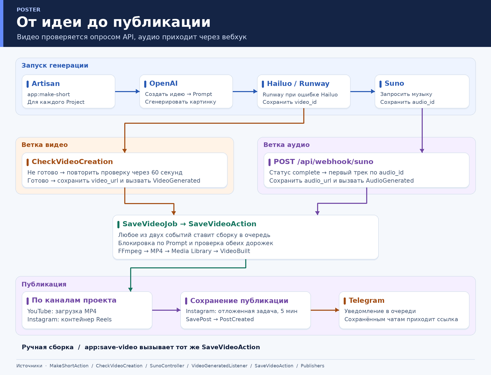
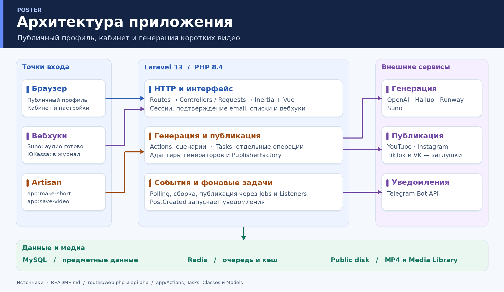

# Poster

Приложение на Laravel 13 / PHP 8.4 для генерации и публикации коротких видео с публичной
страницей разработчика и личным кабинетом на Vue/Inertia.

## Возможности

- Публичные страницы: профиль, политика, условия использования
- Регистрация, сессии, восстановление пароля и настройки профиля
- Списки prompts и публикаций с сортировкой, фильтрами и пагинацией
- Генерация идеи и изображения через OpenAI, видео через Hailuo/Runway,
  музыки через Suno; сборка ролика через FFmpeg
- Публикация в YouTube и Instagram, уведомления в Telegram
- TikTok и VK пока представлены заглушками: публикация возвращает `false`

## Генерация и публикация



## Локальная работа

Docker Compose использует собственные PostgreSQL и Redis, PHP с FFmpeg,
Nginx и Node. Рабочий `.env` с ключами не перезаписывается. Для локального
запуска используется отдельный `.env.docker` по примеру `.env.docker.example`.

```sh
cp .env.docker.example .env.docker
make build
make up
make init # зависимости, APP_KEY при пустом значении, storage link
make migrate
make npm-build
```

Приложение: <http://localhost:8088>. Vite: порт 5178 (`make npm-dev`).
Команды выполняются внутри контейнера; `make help` показывает доступные команды.
Ключи интеграций добавляются только в локальный `.env.docker`; без них внешняя
генерация и публикация недоступны. Автоматические worker/scheduler запускаются
отдельным профилем после настройки ключей: `docker compose --profile workers up -d`.


## Структура и правила

`app/Actions` — сценарии, `app/Tasks` — операции, `app/Classes/Generators` и
`app/Classes/Publishers` — внешние интеграции. HTTP-код находится в
`app/Http`, интерфейс — в `resources/js`, проверки — в `tests`.



Инструкции агентам: [AGENTS.md](AGENTS.md). Правила и скиллы импортированы из
[ai-init](https://github.com/AleksandrSpicyn/ai-init), точная версия —
[docs/ai-init-source.json](docs/ai-init-source.json).

План и результаты модернизации: [docs/modernization.md](docs/modernization.md).

## Проверки

```sh
make pipe # Pint, Rector dry-run, PHPStan max, Pest, Scribe, frontend build
docker compose exec -T --user appuser app npm run typecheck
```

PHPStan анализирует app, bootstrap, public/index.php, config, database, routes и tests на уровне
`max`, без baseline. Pest использует SQLite in-memory и fakes внешних интеграций.
Документация: `make docs`, затем `/docs` после входа. MCP Scribe читает
`storage/app/private/scribe/openapi.yaml`, подключение — `.codex/config.toml`.
Неподтверждённый email не даёт доступа к кабинету и рабочим спискам.

Для обновления подсказок Laravel в IDE после установки зависимостей выполните
`make ide-helper`. Генерируемый `_ide_helper.php` не хранится в Git.
