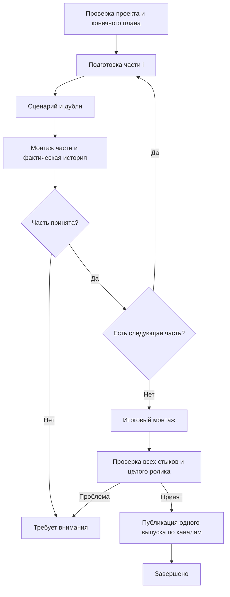

# Реализация единого ролика из сериала или цикла историй

Дата: 17 ноября 2026 года. Статус: первая реализация в рабочей копии;
локальные проверки пройдены, живая приёмка нового сериала не выполнялась.
Базовая ревизия: `be6e0fa`. Продуктовый контракт:
[сериал или цикл — один ролик](series-single-video-plan.md).
Существующий [план сериалов](series-implementation-plan.md) содержит исторические
срезы; ниже исходное поведение сверено с текущим кодом. Прод в рамках проектирования
не проверялся и не изменялся.

## 1. Решение и инварианты

Расширить существующий `Series` способом выпуска `episodes | single_video`.
Сохранить `ProjectContentMode::SERIES`, персонажей, `EpisodeRevision`, дубли,
принятые `EpisodeAssembly` и фактическую память. Один активный `ProductionRun`
обслуживает конечный цикл целиком, а не отдельную часть; итог хранит новая
`SeriesAssembly`. После явной остановки возможен новый запуск того же логического
цикла; старые run сохраняются, а identity выпуска, его ограничения и расходы
остаются общими для `Series`.

Обязательные инварианты:

1. В одном проекте остаётся один сериал. В `single_video` один сериал — один
   конечный цикл и один логический выпуск, независимо от числа пересборок.
2. Каждая часть принимается до генерации зависящего от неё продолжения.
3. Итог содержит все части `1..N` ровно по одному разу, в заданном порядке,
   из текущих принятых сборок этого сериала.
4. Ни одна промежуточная сборка нового режима не может публиковаться.
5. До публикации проверены актуальность всех источников и границы между ними.
6. Один выпуск имеет не более одной подтверждённой публикации на канал.
   Неизвестный внешний исход блокирует повторную отправку.
7. После первого внешнего claim версия итогового файла закреплена для всего
   выпуска, включая ещё не отправленные каналы.
8. Принятие итогового файла не продвигает фактическую историю повторно.
9. Старые схемы snapshots, IDs, файлы и receipts не переписываются миграцией.

## 2. Что есть и что потребуется расширить

| Текущий владелец | Проверенное поведение | Изменение |
|---|---|---|
| [SaveSeries](../app/Tasks/Series/SaveSeries.php), [ProjectData](../app/Data/ProjectData.php) | Паспорт, лимит, версия, автоматизация | Способ выпуска; запрет смены после начала цикла |
| [CreateProductionRun](../app/Tasks/Production/CreateProductionRun.php) | Один эпизод на запуск; завершение по `episode_limit` | Закрепить конечный цикл; не пропускать финальный монтаж после достижения лимита |
| [ProduceSeriesSubAction](../app/Actions/Production/ProduceSeriesSubAction.php) | Подготовка → сценарий → медиа → монтаж → история → публикация | Цикл по частям и новые финальные стадии |
| [ConfirmSeriesStorySubAction](../app/Actions/Production/ConfirmSeriesStorySubAction.php) | После принятия всегда `PUBLICATION` | Следующая часть либо финальная сборка; без публикации части |
| [BuildEpisodeContext](../app/Tasks/Episodes/BuildEpisodeContext.php), [GenerateEpisodeScript](../app/Tasks/Episodes/GenerateEpisodeScript.php) | Паспорт, факты, прошлые замыслы; до 50 эпизодов / 64 КБ | Роль части в общем плане, режим выпуска и согласованная граница |
| [PrepareShotContinuation](../app/Tasks/Shots/PrepareShotContinuation.php) | Закреплённый источник; закрытая сцена запрещает `continue_scene` | Развести локальную сюжетную развязку и разрешённую физическую непрерывность внутри единого ролика |
| [BuildEpisodeAssembly](../app/Tasks/Episodes/BuildEpisodeAssembly.php) | 720×1280, 24 fps, AAC 48 kHz stereo; нормализация и concat файлов | Общая временная шкала и проверяемые стыки финального видео |
| [AcceptEpisode](../app/Tasks/Episodes/AcceptEpisode.php) | Продвигает канон, инвалидирует последующие эпизоды | Также инвалидировать зависимые неопубликованные итоговые сборки |
| [PublicationRequest](../app/Models/PublicationRequest.php), [ClaimPublication](../app/Tasks/Publications/ClaimPublication.php) | Источник только `EpisodeAssembly` | Явный источник episode/series assembly, запрет внутренних публикаций |
| [PublishVideoData](../app/Data/PublishVideoData.php), [PostData](../app/Data/PostData.php) | Метаданные привязаны к сборке эпизода | Поддержать точную сборку цикла без фиктивного эпизода |
| [AdvanceProductionAction](../app/Actions/Production/AdvanceProductionAction.php), [StopProductionRun](../app/Tasks/Production/StopProductionRun.php) | Общий deadline запуска; остановка вокруг текущего эпизода | Лимиты длинного цикла, остановка всех принадлежащих запуску операций |

Сейчас `EpisodeAssemblyPlanData` ограничивает монтаж 100 планами и 600000 мс;
`BuildEpisodeAssembly` — размер исходного файла 500000000 байт и работу 3300 секундами.
`InspectEpisodeOutcome` также ограничен 600000 мс, а стандартный запуск —
`production.run_timeout_minutes`, сейчас 180 минут. Это границы существующего кода,
а не подтверждённая производительность нового итогового монтажа.

## 3. Модель данных

Все новые enum используют `App\Traits\EnumTrait`, внутренние контракты — DTO.
Ниже целевые поля; точные типы и FK уточняются по текущим миграциям перед этапом P1.

| Владелец | Новые данные / назначение |
|---|---|
| `series` | `output_mode` с default `episodes`; nullable `final_assembly_id` — принятая итоговая сборка; nullable `release_started_at` — постоянная отметка первого внешнего claim; nullable `cycle_paused_at` — запрет автоматического старта после остановки. `canonical_assembly_id` по-прежнему указывает на последний принятый эпизод |
| `production_runs` | `output_mode`, `input_snapshot` с настройками/каналами/версиями; immutable `cycle_plan_snapshot` и hash; `series_assembly_id`; `lock_version`, `stage_started_at`, привязка `outcome_snapshot` к точному `episode_assembly_id` |
| `series_assemblies` | `series_id`, `number`, status, validity, `manifest`, `manifest_hash`, media, `duration_ms`, `lock_version`, error, автор/дата принятия, зафиксированный отчёт проверки |
| `series_assembly_items` | `series_assembly_id`, position, `episode_assembly_id`; FK и индексы зависимостей. Точные trims/переходы находятся в manifest, не дублируются второй редактируемой моделью |
| `publication_requests` | Nullable `episode_assembly_id` и `series_assembly_id` с XOR; nullable `release_key` для нового режима; версия закреплённого источника |
| `posts` | Nullable `series_assembly_id`; связь с тем же `publication_request_id`, сохранение всех прежних nullable-связей |

Ограничения: unique `(series_id, number)` у итоговых сборок; unique позиции и
исходной сборки внутри списка items; FK запрещают удаление используемого источника.
Принадлежность одному сериалу, полнота и соответствие номера проверяются под lock.

У `PublicationRequest` источник ровно один; текущие строки остаются с
`episode_assembly_id`. Сохранить прежний unique `(episode_assembly_id, channel_id)`
и добавить `(series_assembly_id, channel_id)` и `(release_key, channel_id)`.
Для нового режима ключ стабилен: `series:{id}:single_video`. Только unique по
версии сборки недостаточен: пересборка иначе разрешит второй upload того же цикла.
Новая сущность сезона/релиза пока не нужна: один цикл на `Series` задан контрактом.

Для новых `Post` валидировать единственный источник в DTO/Task. Не вводить
глобальный обязательный FK/XOR, который сделает незаконными прежние строки
истории с уже удалёнными nullable-связями. Сетевые адаптеры получают типизированный
источник, а запись результата сохраняет его точные IDs и receipt.

Итоговые версии неизменяемы после постановки в сборку; изменение manifest создаёт
новый номер. Status отражает `draft → queued → building → ready → accepted` либо
`failed`; validity отдельно обозначает `current | requires_review`. Обнаруженная
неактуальность не уничтожает ready/accepted файл и его историю.

## 4. План всего ролика и контекст части

Добавить стадию `planning` для нового режима. После проверки исходных настроек
формируется `CyclePlanData`, сохраняемый в запуске до начала платных медиа-операций:

- `schema_version`, `structure` (`continuous_story | anthology`), число частей;
- общий замысел, бюджет длительности и итоговый результат;
- для каждой части: номер, цель, новый сюжетный шаг, ожидаемый вход/выход;
- логические `scene_key` и граница к следующей части: существующий `TransitionMode`,
  ограничения времени/места/ракурса, требуется ли непрерывное действие;
- единый звуковой план и ограничения публикационного профиля.

План — намерение, не канон. Следующая часть генерируется после принятия предыдущей
из её фактического результата. Допустимая вариация меняет постановку внутри цели;
противоречие обязательной дальнейшей истории переводит запуск в `needs_attention`,
не переписывает факты и не автоматически оплачивает каскад дублей.

В `BuildEpisodeContext` передавать только нужный текущий/соседний участок плана
и краткое направление целого; полный snapshot остаётся у run. Лимит 64 КБ сохраняется,
обязательная граница и финал источника не обрезаются. В context/hash включить режим,
plan hash, номер части и граничный контракт. Старые snapshots читать прежним способом.

`ProduceSeriesScreenplaySubAction` выбирает brief по режиму выпуска. В `single_video`
техническая граница не требует нового hook, нового места или завершения всего сюжета.
Финал части соответствует плану; открытие и окончание выпуска только по краям цикла.
Антология сохраняет локальные развязки. Нельзя глобально отменять прежние правила
самостоятельных эпизодов ради нового режима.

После старта зафиксировать настройки, состав каналов и план. Изменение версии
паспорта/персонажа, затрагивающее незавершённый цикл, останавливает новые claims
до проверки. План не редактируется незаметно под уже сгенерированными частями:
новое намерение сохраняет новую версию, переиспользуя только явно совместимые
принятые части и сохраняя snapshots старого запуска.

Тот же контракт действует на ручных входах. `CreateEpisode` не создаёт часть N+1
или часть вне принятого плана; сохранение сценария проверяет её роль и границу;
ручной запрос генерации и его claim резервируют общий бюджет цикла под тем же
Series lock. Наличие `production_run_id=null` не освобождает от этих проверок:
цикл определяется через Shot → Episode → Series. Оплаченные и неизвестные попытки
учитываются по всему циклу, включая прежние run и ручные дубли. Ручная публикация
принимает только канал из закреплённого плана доставки. Изменение плана, границ
или состава доставки — явное версионируемое действие с повторной проверкой,
не побочный эффект редактирования отдельного эпизода.

## 5. Конвейер и возобновление

Стадии частей переиспользуют существующие `preparing/screenplay/media/montage/story`.
Добавляются `planning`, `final_montage`, `final_review`. В `episodes` остаётся
старый переход `story → publication`.

После принятия части `i < N` под общими locks сохранить результат, переключить
курсор `episode_id`, очистить `episode_assembly_id` и предыдущий `outcome_snapshot`,
перейти к подготовке следующей части. Analysis-result и callbacks проверяют
ожидаемые run version, stage и assembly ID; поздний анализ части i не применяется
к i+1. Исторические операции остаются связанными с тем же run и своими Prompt.

После последней части переходить к финальному монтажу внутри этого run.
`CreateProductionRun` не должен трактовать достижение `episode_limit` как конец
всей работы, пока итоговый выпуск не готов и не доставлен. Повтор scheduler
находит текущий цикл; после завершения не начинает новый без нового проекта.
Работа внутри цикла продолжается очередью, а не ожидает следующего суточного запуска.

Добавить явный `ResumeProductionAction` для `needs_attention`: перепроверить
источники/права/исправленную причину и продолжить ту же безопасную стадию.
`submission_unknown` сначала разрешается существующим recovery; resume не означает
повтор внешней отправки. Остановленный run не оживает сам. Остановка цикла атомарно
устанавливает `Series.cycle_paused_at`; scheduler и обычное сохранение/включение
проекта или автоматизации не снимают эту отметку и не создают заменяющий run.
Явное действие «Продолжить остановленный цикл» перепроверяет план и unresolved
операции, снимает запрет и создаёт новый run с новым разрешением, сохраняя
совместимые результаты и общую identity выпуска. При блокирующем unknown новый
эффект по-прежнему запрещён. Любой дополнительный платный дубль остаётся отдельным намерением.

Завершение: финальная сборка принята и каждый закреплённый канал подтвердил
доставку. Частичный успех сохраняется как таковой; повтор работает только с
незавершёнными каналами того же файла. Канал, отключённый в процессе, не исчезает
из плана доставки молча — требуется явное решение оператора.

## 6. Источник продолжения и монтажные границы

Граница фиксирует IDs обеих частей/сборок, режим перехода, источник кадра,
checksum, точку OUT слева и IN справа. Для `continue_scene` источник следующего
первого кадра должен совпадать с реально включаемым концом предыдущей части.
Значение «последний кадр» разрешается в конкретный индекс/время до генерации.
Изменение OUT после генерации зависимого продолжения инвалидирует стык.

Существующий `scene_closed` сохраняет фактическую завершённость локальной ситуации.
В новом режиме закрытая локальная задача может иметь следующее действие в том же
непрерывном кадре. `PrepareShotContinuation` разрешает это только при согласованном
граничном контракте единого ролика, том же `scene_key`, актуальном accepted source
и отсутствии противоречащего фактического перехода времени/места. Legacy-режим
сохраняет нынешний запрет. Не обходить проверку принудительным `scene_closed=false`.

Смена ракурса использует существующий `new_shot` с референсом источника; новая
сцена использует `new_scene`. Не добавлять второй несовместимый набор этих режимов.
Монтажный эффект (cut или разрешённый переход) — отдельное свойство границы,
а не новое значение сюжетного `TransitionMode`.

В первой версии использовать текущий first-frame путь. Наличие финального кадра
и двухсекундного хвоста не равно нативному продлению видео. Интеграция EXTEND —
отдельный эксперимент с capability-проверкой и выяснением, включает ли ответ
исходное видео; нельзя незаметно продублировать его при монтаже.

## 7. Итоговый manifest, renderer и звук

`SeriesAssembly` закрепляет ordered items, их media/checksums, source manifest hashes,
плановые версии, trims и переходы, единый профиль картинки/звука и рассчитанную шкалу.
Снимок должен позволять воспроизвести итог без новых генераций.

**Источник первой версии — принятые MP4 эпизодов.** Декодировать их, привести к
общей временной шкале, собрать видео/звук и выполнить одно финальное кодирование.
Это не обещание «одно кодирование от исходных дублей»: части уже были кодированы.
Так итог опирается именно на просмотренные и принятые материалы. Оптимизацию
через разворачивание manifests в сырые дубли отложить до доказанной эквивалентности
трима, кадров продолжения, звука и фильтров принятому монтажу.

Общий низкоуровневый renderer выделить из существующего FFmpeg-кода при появлении
второго потребителя. Владельцы Episode/Series отдельно проверяют модели, доступ,
актуальность и источники; renderer получает DTO разрешённых локальных файлов
и временной шкалы, ничего не запрашивает из БД и не публикует. Не вызывать Task
из Task и не строить универсальный workflow/media framework.

Технический контракт:

- Зафиксировать размеры, fps, pixel format, audio sample rate/layout в профиле.
  Для первого прототипа использовать существующий 720×1280/24 fps/48 kHz stereo.
- Переводить trims в общую кадровую/сэмпловую сетку. Проверять PTS/DTS, A/V offset,
  повтор и пропуск граничного кадра, фактическую длительность и накопленную ошибку.
- Cut не добавляет паузу. Повторный кадр удаляется только на проверенной границе;
  намеренная пауза не считается дефектом автоматически.
- Crossfade применяется только по плану; video overlap уменьшает итоговую длину
  и отражается в шкале. Audio overlap считается отдельно и не должен сдвигать речь.
- Native-аудио декодируется в общий поток до финального кодирования; обработка
  границы не обрезает реплики и смысловые эффекты. Silent заменяет весь звук тишиной.
- Общий фон/музыка: приватный Media Library asset, checksum, gain, start/end и
  fades на шкале целого ролика; не перезапускается на эпизодах. Новый внешний
  генератор музыки или source separation для этого не требуется.
- Применять ограничение размера файлов, времени, временного диска и параллельности;
  безопасные локальные пути, без произвольных filter expressions из HTTP.

FFmpeg требует согласованных потоков/time base при concat; неточная длительность
входов может нарушить стык. Конкретный фильтр и расчёт переходов проверяются на
установленной версии, а не выбираются по одному примеру команды.
Источники: [FFmpeg concat](https://ffmpeg.org/ffmpeg-formats.html#concat),
[filters: concat/acrossfade/xfade](https://www.ffmpeg.org/ffmpeg-filters.html).

## 8. Проверка и актуальность

Добавить `InspectSeriesAssembly` с отчётом, привязанным к manifest hash и checksum
итогового файла. Проверять техническую валидность, полноту частей, общий сюжет,
каждый стык и завершение всего ролика. Шесть равномерных кадров длинного видео
недостаточны: готовить контроль каждой границы и preview «хвост + начало» со звуком.

Технические проверки автоматизируются. Просмотр кадров не доказывает плавность
движения или качество реплик: автоматический режим не получает `passed` для
неподдерживаемой проверки. Нужен совместимый анализ либо операторское принятие;
неопределённость даёт `needs_attention`. Первый живой пилот проверяется человеком.
Смена материала сбрасывает его прежнее одобрение.

Для каждого item проверять: сериал, номер, `Episode.validity=current`, accepted
status и равенство `Episode.accepted_assembly_id`, доступность media и checksum.
Не требовать, чтобы у всех старых частей `base_continuity_version` равнялся текущему
значению сериала: принятые прошлые части законно содержат прошлые версии.

После замены ранней части `AcceptEpisode` инвалидирует зависимый хвост и итоговые
кандидаты. Файл опубликованного выпуска и receipt сохраняются. Если первый upload
уже начат, никакая поздняя пересборка не меняет источник оставшихся доставок:
остановить работу и показать конфликт; новую редакцию не выпускать автоматически.

## 9. Публикация одного логического выпуска

Расширение должно пройти весь путь, а не только кнопку:

- `CreatePublicationRequest`, `ClaimPublication`, `PublicationRequestRepository`;
- подготовка источника (`PrepareEpisodePublication` и отдельная подготовка Series);
- `PublicationClaimData`, `PreparedPublicationData`, `PublishVideoData`, `PostData`;
- `AbstractPublisher`, `SavePost`, source-based проверки `ChannelRepository`;
- signed export финального файла, Resources/проекции проектов и Posts;
- отложенный Instagram finish и проверка неизвестной публикации.

Запретить публикацию `EpisodeAssembly` при `single_video` на create и claim,
включая ручной endpoint и delayed container publish. Финальный export проверяет
разрешённый источник и checksum; публикация проверяет ещё и актуальность перед
внешним эффектом. Уже отправленному провайдеру обеспечить доступ к закреплённому
файлу на согласованный срок даже при появлении новой кандидатной версии.

Первый внешний claim под lock закрепляет `Series.final_assembly_id` как источник
логического выпуска и атомарно устанавливает `Series.release_started_at`.
Эта отметка не сбрасывается при failed, отмене или unknown: текущий статус запроса
не доказывает, что внешней отправки ещё не было. До первого claim можно обновить
только ещё не отправленные planned requests при новом явном принятии сборки,
атомарно с версиями источника. После установки отметки источник нельзя заменить
ни для одного канала, даже если запрос позже завершился ошибкой. `submitting`, `processing`,
`publishing_container`, `submission_unknown`, `published` не допускают такой замены.
Уникальность release key и сверка receipts защищают повторные jobs и rebuild.
Это локальная защита от дублей; exactly-once во внешнем API не обещается.

До генерации проверять плановую длину/профиль всех закреплённых каналов; перед
upload — фактический файл. Неподдерживаемый полный ролик не сокращается и не
делится на несколько публикаций автоматически. Сейчас YouTube-адаптер формирует
`/shorts/` URL, Instagram использует `REELS`: предусмотреть корректную ссылку/профиль
полного видео. Числовые лимиты платформ проверяются по их документации на P0,
а не наследуются из лимита одного генеративного плана.

## 10. Конкурентность и эксплуатация

Порядок locks: Project → Series → Run → Episode/Assembly → Operation/Request.
Переход run проверяет ожидаемые stage, cursor и `lock_version`; обновление только
по ID без проверки текущего шага может применить запоздалый результат другой части.
Внешние вызовы и FFmpeg выполняются вне DB-транзакции; намерение/claim сохраняются
до эффекта, постановка job — после commit.

`StopProductionRun` охватывает все операции с данным `production_run_id`, а не
только текущий cursor. Остановить ещё не начатые генерации, финальную сборку и
публикации; сохранить поступившие receipts/скачанные файлы, не принимая их
автоматически и не продолжая отменённый выпуск.

Отдельно задать deadline текущей стадии и всего цикла. `stage_started_at`
обновляется при реальном переходе, не при каждом polling; исходный `started_at`
не сбрасывается. Согласовать render timeout, worker timeout, retry_after и lock TTL.
Для нового режима добавить reconciliation финальных сборок и обнаружение
потерянного dispatch, сохраняя существующие ограничения unknown.

Начальные ограничения для проектирования: до 20 частей, 100 планов суммарно,
не более 600 секунд итогового видео и более строгий предел выбранных каналов.
Это предлагаемый стартовый профиль, не измеренный SLA. P0 подтверждает либо
уменьшает его на целевой машине до включения функции. Лимиты попыток и оплачиваемых
генераций задаются на весь цикл, а не умножаются незаметно на каждый этап восстановления.

## 11. HTTP, кабинет и владельцы кода

Сохранить Controller → Action → Task → Repository, `run()` и локальные SubActions.
Новые сценарии: подготовка плана цикла, запрос/сборка/принятие итогового монтажа,
публикация итогового источника и проверяемое возобновление. Их размещение —
существующие `app/Actions`, `app/Tasks`, `app/Repositories`; без нового приложения.

Планируемая группа `series.assemblies.*` включает index/show, store, accept,
export и запрос публикации. Привязка вложенных моделей scoped к сериалу,
авторизация через действующий `manageSeries`; export — существующий подход
подписанного ограниченного URL. Один `__invoke` на контроллер, Laravel Data для
входов, enum-типы в DTO, Resources без credentials и приватных путей.

Расширить `ProjectSeriesFields`, страницы проекта/эпизода, проекцию run и Posts.
Показывать план, часть i/N, полный прогресс, стыки, итоговый файл и статус каналов.
Для нового режима убрать отправку эпизода из UI, но серверный запрет обязателен.
Закреплённый после начала публикации файл явно отличать от нового черновика монтажа.
Использовать существующий Reverb/reload; обновления не перетирают редактируемые поля.

## 12. Последовательность реализации

Каждый этап завершается своим критерием; пункты ниже ещё не выполнены.

| Этап | Работа | Критерий завершения |
|---|---|---|
| P0. Проверить монтаж и ограничения | Прототип на локальных fixtures: продолжение, новый план, новая сцена, речь/тишина/фон; сверить модели и профили каналов, измерить ресурсы | Зафиксированы воспроизводимые параметры, временная шкала, пределы и метод проверки каждого стыка. Платный пилот отдельно от tests |
| P1. Схема и режим | Миграции, enum/DTO, SeriesAssembly/items, XOR и release key, флаг доступности | Старые данные читаются прежним способом; переключение после старта запрещено; миграции проходят SQLite/MySQL |
| P2. План и промпты | `CyclePlanData`, frozen context запуска, роль части, границы, жанры, бюджет контекста | Непрерывная история и антология дают разные корректные задания; часть не получает чужую концовку |
| P3. Цикл производства | Ветвление `story`, cursor/CAS, общие лимиты и ручные guards, resume, pause latch, stop/reconcile | Три части создаются одним run; ни одной промежуточной публикации; повторы не перескакивают часть и не оживляют остановленный цикл |
| P4. Общий монтаж | Manifest/items, renderer, кадры OUT/IN, звуковая шкала, проверка и инвалидирование | Реальный локальный FFmpeg даёт проверяемое цельное видео, плохой/устаревший стык блокирует принятие |
| P5. Единая публикация | Весь source-aware путь, stable release, exports, delayed jobs, channel preflight | По одному Post на выбранный канал; rebuild/unknown/retry не создают второй выпуск |
| P6. Кабинет и документация API | Настройки, план, прогресс, preview стыков, финальный монтаж, recovery, Scribe | Полный сценарий доступен в UI, ошибки понятны, приватные данные не раскрываются |
| P7. Выпуск и живой пилот | Регрессия, CI, additive deploy, проверка на целевой модели/каналах | Три живых примера из продуктовых критериев просмотрены со звуком; подтверждён ровно один выпуск на канал |

P0 → P1 → P2 → P3 → P4 → P5 → P6 → P7. Каркас интерфейса можно вести параллельно
после фиксации DTO, но включать функцию до завершения серверных запретов нельзя.
Не отмечать живой критерий выполненным по fake-ответу генератора.

## 13. Матрица проверок

| Область | Существенные случаи |
|---|---|
| Совместимость | Legacy short/episodes без изменений; старые Post с nullable-источником; новый режим по умолчанию выключен |
| План | Конечный N, полнота и уникальность частей, лимит длительности/планов/контекста, чужие персонажи, жанр и антология, отсутствие повторных вступлений; ручные N+1, генерация сверх общего бюджета и незакреплённый канал отклоняются |
| История/стык | Только accepted predecessor; local goal closed при разрешённом физическом продолжении; legacy closed по-прежнему запрещён; изменение OUT, source hash или ранней части инвалидирует хвост |
| Запуск | Duplicate scheduler/dispatch, два workers, поздний callback предыдущей части, остаточный outcome_snapshot, финальный монтаж при достигнутом episode_limit |
| Manifest | Пропуск/дубль/перестановка части, чужой сериал, неактуальная accepted pointer, отсутствующий media, другой checksum, malformed trims |
| Реальный FFmpeg | 1/2/3 части; cut и согласованный overlap; известные кадровые маркеры и аудиосигналы; монотонность timestamps, длина, A/V sync, silent, непрерывность фоновой дорожки; возврат после process failure |
| Качество | Плохой стык/повтор движения/оборванная реплика → needs_attention; преднамеренная пауза/превращение/диалог не объявляются дефектом только по отсутствию движения |
| Публикация | Create/claim/delayed job запрещают внутренний эпизод; неутверждённый финал не отправляется; release unique, повтор callbacks и rebuild; неизвестная отправка блокирует новую; failed после claim не сбрасывает release_started_at и не разрешает сменить файл второго канала |
| Несколько каналов | Первый опубликован, второй pending/failed; повтор не трогает первый; все используют один hash; отключение/отвязка канала и неподходящий профиль |
| Остановка/возобновление | Stop на каждой стадии, поздний receipt без новых эффектов, потеря dispatch, stage/cycle deadline, исправление причины и безопасный resume; следующий scheduler/включение проекта не обходят cycle_paused_at; новый явный run не обнуляет бюджет и release key |
| Доступ/UI | Gate и scoped IDs, signed export и его срок, отсутствие приватных путей/токенов, stale form, reconnect и видимость единственной точки публикации |

Pest: отдельный Feature-файл на HTTP method + named route, реальные сценарии
через factories/relations; внешние API/CLI генерации и уведомления fake.
Настоящий FFmpeg проверяется короткими локальными fixtures. Рабочая БД и реальные
платные API в тестах запрещены. SQLite и MySQL запускать последовательно.
После PHP — Pint/Rector/PHPStan, после UI — TypeScript/build и проверка интерфейса;
обновить Scribe и Graphify. CI/deploy/live-приёмку фиксировать раздельно.

## 14. Выпуск и откат

Миграции сначала добавляют nullable-поля/таблицы и default `episodes`; новый режим
закрыт флагом доступности. Обновить всех consumers нового типа источника до
разрешения создания таких записей; не оставлять старые workers рядом с новым writer.
Deployment сохраняет приватные media, snapshots и receipts.

Первый пилот: непрерывная история, история со сменой сцены, антология; проверить
движение, звук и отсутствие промежуточных публикаций. Фактические расходы/внешние
действия выполняются отдельным эксплуатационным запуском, не внутри тестов.

Откат сначала запрещает новые циклы и при необходимости останавливает их эффекты.
Не удалять таблицы/файлы и не переключать `single_video` в `episodes`: это может
разрешить нежелательную публикацию частей. Пока есть новые записи, применять
код, умеющий их безопасно читать и завершать recovery. Не запускать автоматический
rollback схемы поверх начатых uploads. Публикации внешнего сервиса не отменяются
откатом БД.

Готовность функции — выполнение всех продуктовых критериев, живые проверенные
стыки и подтверждённая доставка единого выпуска. Наличие кнопки «Склеить» либо
одного MP4 без проверки источников, звука и защиты публикации этим критериям не равно.

## 15. Текущая реализация и проверка

Реализованы режимы `episodes/single_video`, конечный структурированный план,
выбор единой сцены или смены сцен, последовательное производство частей,
отдельный итоговый монтаж, просмотр стыков, принятие и единый выпуск по каналам.
Работают закрепление источников, канонические hash snapshots, блокировка публикации
частей, stable release key, pause/resume и ограничения общих попыток.

Первая версия использует cut на границах, общий профиль видео и нормализованный
native/silent звук; отдельная загружаемая фоновая дорожка и crossfade остаются
дальнейшими расширениями. Проверка движения и звука финального ролика выполняется
оператором: автоматический анализ нескольких кадров не заменяет эту проверку.
Нативное EXTEND в этот путь не добавлено.

Длительность новой генерации по умолчанию 15 секунд. Настройки эпизода и генерации
независимы: 60-секундный эпизод с 15-секундным планом использует четыре генерации.
Миграция настроек заменяет прежний default 10 на 15, сохраняя другие явные значения;
исторические запросы и длительности проектов не изменяются.

Локально проверены настоящим FFmpeg сборка принятых частей и временная шкала;
внешние генераторы, публикации и уведомления подменены. Полные SQLite и MySQL:
808 тестов / 4124 assertions на каждой базе. PHPStan, Pint, Rector, TypeScript,
ESLint и client/SSR build пройдены. Доставка CI/CD и живой пилот этими проверками
не подтверждаются. По просьбе пользователя новый сериал создаётся и проверяется
на проде совместно; в этой работе прод не тестировался.

Справка по профилям: [официальный пример Meta](https://github.com/fbsamples/reels_publishing_apis/tree/main/insta_reels_publishing_api_sample)
и [YouTube videos.insert](https://developers.google.com/youtube/v3/docs/videos/insert).
Рабочий профиль приложения ограничен 600 секундами; файл Instagram проверяется
на предел 300 MB перед отправкой, итоговая картинка — 720×1280, 24 fps.
